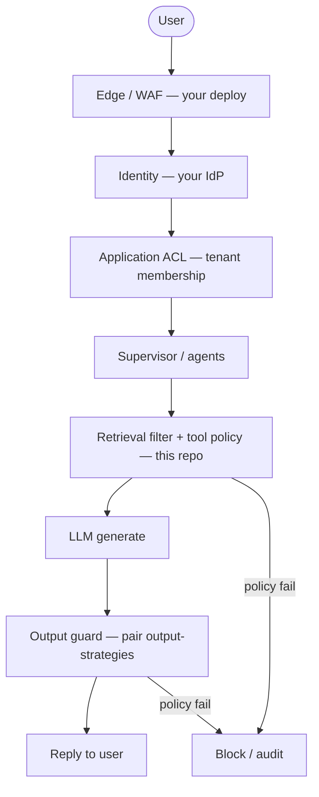

# Guardrails Strategies

**Reference implementation** of current **best practices** for **layered guard-rails** in RAG and multi-agent systems: identity → application ACL → retrieval filter → tool policy → output gate—so you **prove** tenant boundaries, tool scope, and unsafe content handling before generation results reach users or downstream agents.

The patterns match [AI-System-Architecturing-Engineering → guard-rails](https://github.com/CaioHAndradeLima/AI-System-Architecturing-Engineering/tree/main/guard-rails). This repo ships **recommended defaults** (`layered_guardrails`, measure gates, CI profile `ci-guardrails-eval`) plus a **fixed regression corpus** (multi-tenant documents, cross-tenant attacks, tool hijack, injection-in-chunk scenarios) so you can compare policy changes before wiring real IdP and vector filters.

### Where guard-rails run (multi-agent stack)



Optional feedback: policy failure → block (no silent bypass).

---

## 1. What are guard-rails in a multi-agent system?

**Guard-rails** are enforceable checks at **trust boundaries**: who the caller is, which tenant they may act for, which documents and tools are in scope, and whether model output may be delivered. Prompt-only instructions are not sufficient; rules must run in **your** backend before data access and again before responses.

Upstream [contexting-strategies](https://github.com/CaioHAndradeLima/contexting-strategies) assembles evidence; [output-strategies](https://github.com/CaioHAndradeLima/output-strategies) validates post-generation answers. This repo focuses on **pre- and peri-execution** policy orchestration and **regression** against golden attack scenarios.

---

## 2. Guarantee enforceable boundaries — mechanisms

You **measure and gate** policy logic against labeled fixtures—not assume the model “knows” tenant rules.

| Mechanism | What it checks | Reference implementation |
| --- | --- | --- |
| **Identity** | Authenticated user present | `policy_pipeline.check_identity` |
| **Application ACL** | Tenant membership, spoofed `tenant_id` | `policy_pipeline.check_app_acl` |
| **Retrieval filter** | Doc/chunk tenant matches request | `tenant_scoped_retrieval.py` |
| **Tool policy** | Allowlist + tenant args on tool calls | `policy_pipeline.check_tools` |
| **Output gate** | Unauthorized citations, injection in answer | `policy_pipeline.check_output_gate` |
| **Cache / worker context** | Cross-tenant cache and async jobs | `check_cache_isolation`, `check_worker_context` |
| **Observability** | Block raw retrieved content log export | `check_observability` |

**Recommended check on every change:**

```bash
pip install -e .
guardrails-lab evaluate-pipeline --profile ci-guardrails-eval --output reports/pipeline-eval.json
guardrails-lab check-measure --profile ci-guardrails-eval --report reports/pipeline-eval.json
```

Details: [docs/PIPELINE_EVAL.md](docs/PIPELINE_EVAL.md).

---

## 3. Avoid blind spots

| Risk | Mitigation | Reference implementation |
| --- | --- | --- |
| **False allow on filter bugs** | Shared-index anti-pattern metrics | `shared_index_simulation.py` |
| **False deny UX** | Track `false_deny_rate` on legit fixtures | `metrics.py` |
| **Prompt-only “security”** | Compare `prompt_only` vs `layered_guardrails` | `measure --profile ci-all-strategies` |
| **PII across tenants in logs** | Deny log export with retrieved content | `check_observability` |
| **Tool tenant hijack** | Reject mismatched `tenant_id` in tool args | golden + test-use-cases |

---

## 4. Loops

| Loop type | When | Covered in this repo |
| --- | --- | --- |
| **CI policy eval** | Change policy → `evaluate-pipeline` → gate | `ci-guardrails-eval`, `measure-gate.yml` |
| **Release gates** | Block merge on attack regression | `check-measure` |
| **Test-use-case regression** | Every row in guard-rails test table | `data/test_use_cases.json`, `evaluate-scenarios` |

---

## 5. Strategies — when to use which

| Strategy | Name in code | Use when | Trade-off |
| --- | --- | --- | --- |
| **Prompt scan only** | `prompt_only` | Baseline / anti-pattern demo | Misses ACL, retrieval, tools |
| **App ACL only** | `app_acl_only` | MVP with trusted retrieval | No retrieval/tool/output depth |
| **Layered guard-rails** | `layered_guardrails` | **Recommended default** for multi-tenant RAG/agents | More checks; tune false-deny |

**Regression snapshot (bundled `golden.json`, local run):**

| Strategy | Attack block rate | Classification accuracy |
| --- | ---: | ---: |
| `prompt_only` | 0.09 | 0.33 |
| `app_acl_only` | 0.36 | 0.53 |
| `layered_guardrails` | 1.00 | 1.00 |

Compare: `guardrails-lab evaluate` or `guardrails-lab measure --profile ci-all-strategies`.

Pair with **[output-strategies](https://github.com/CaioHAndradeLima/output-strategies)** for post-LLM validation and **[observability-strategies](https://github.com/CaioHAndradeLima/observability-strategies)** for incident and canary fixtures.

---

## 6. Metrics

### 6.1 Scorecard (`evaluate-pipeline`)

See `scorecard.core_quality` and [PIPELINE_EVAL.md](docs/PIPELINE_EVAL.md).

### 6.2 Full guide coverage (`evaluate-full`)

One JSON for all fourteen guard-rails guides — map: [docs/LAB_COVERAGE.md](docs/LAB_COVERAGE.md) (14/14).

### 6.3 Strategy comparison (`measure`)

`summary.<strategy>` per profile in [config/measure_profiles.json](config/measure_profiles.json).

---

## 7. Commands (cheat sheet)

| Goal | Command |
| --- | --- |
| **PR / regression gate** | `evaluate-pipeline --profile ci-guardrails-eval` + `check-measure` |
| Compare policy strategies | `evaluate` or `measure --profile ci-all-strategies` |
| Scenarios only | `evaluate-scenarios` |
| Full doc checklist | `evaluate-full --output reports/full.json` |
| Docker CI | `./scripts/docker-ci.sh ci-guardrails-eval` |

Requires **Python 3.10+**:

```bash
python3 -m venv .venv && source .venv/bin/activate
pip install -e .
```

---

## 8. Adopting this in production

1. **Keep `layered_guardrails` + `ci-guardrails-eval`** as minimum bar; tune gates in [config/measure_profiles.json](config/measure_profiles.json).
2. **Replace fixtures** — swap `data/documents.json`, `golden.json`, and `test_use_cases.json` for your tenants, ACL matrix, and attack catalog.
3. **Wire real boundaries separately** — IdP claims, vector DB metadata filters, and tool IAM live in your services; this repo proves policy **logic** offline.
4. **Pair upstream repos** — contexting for authorized evidence sets; output-strategies for answer validation; observability-strategies for trace/incident gates.
5. **Not included here** — live Bedrock Guardrails / Model Armor / Azure Content Safety deploy, org-wide IAM, WAF/Shield Terraform (`maturity.production_deployment_only` in `evaluate-full`).

Bundled scores are for **regression between policy changes**, not published SLAs.

---

## 9. Development

```bash
python -m unittest discover -s tests -v
```

**GitHub Actions:** [measure-gate.yml](.github/workflows/measure-gate.yml) (unit tests + Docker profile matrix including `ci-guardrails-eval`).

**Data:** `data/documents.json`, `data/golden.json`, `data/test_use_cases.json`.

**Related:** [Guard-rails docs](https://github.com/CaioHAndradeLima/AI-System-Architecturing-Engineering/tree/main/guard-rails) · [PIPELINE_EVAL.md](docs/PIPELINE_EVAL.md) · [LAB_COVERAGE.md](docs/LAB_COVERAGE.md)
